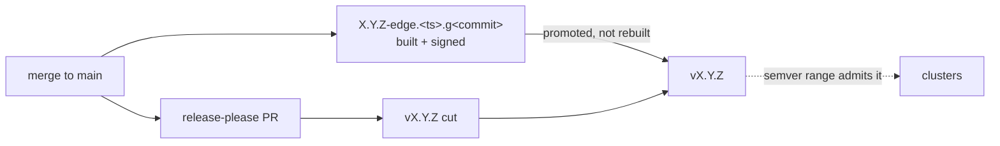

# Releases & channels

Every tag is immutable. Clusters follow **releases** through the seed's semver range (`PATCHY_MANIFESTS_SEMVER`); edge
builds exist for development clusters, `flux pull artifact`, and the platform's own smoke tests.

| The release workflow's push… | The publish job                                                                                                |
| ---------------------------- | -------------------------------------------------------------------------------------------------------------- |
| cuts no release              | builds `manifests/` and pushes it as `manifests/patchy:<next version>-edge.<yyyymmddhhmmss>.g<commit>`, signed |
| cuts `vX.Y.Z`                | adds `vX.Y.Z` to the newest `X.Y.Z-edge.*` build, without rebuilding                                           |



An edge build is based on the **next** version, the open release PR's, so the order is consistent: `0.1.0` <
`0.2.0-edge.*` < `0.2.0`. Edge builds are pre-releases, so a plain range such as the default `<1.0.0 >=0.1.0` never
admits one. Before promoting, the release workflow checks that the newest edge build was built from a commit with the
release commit's `manifests/` tree, so a release is exactly what edge clusters ran.

Publishing is the release workflow's `publish` job, which runs github-workflows'
[`patchy-publish`](https://oss.bitwisemedia.uk/github-workflows/actions/patchy-publish/) action after release-please.
`patchy.yaml` holds only the `build:` block; `make build` packages the image without publishing it.

## Signing

Signing is keyless. The Fulcio certificate subject is this repository's release workflow on `main`, which is what the
seed's `OCIRepository` verify block (`SIGNED_IDENTITY_PATCHY_MANIFESTS`) matches on every cluster:

```text
https://github.com/bitwise-media-group/patchy-app-manifests/.github/workflows/release.yaml@refs/heads/main
```

Edge builds and releases carry the same signature, because a release is a promoted edge build. cosign v3 stores the
signature as a sigstore bundle through the OCI referrers API. Setting the `SIGNING_KMS_KEY` org variable switches
signing to a KMS key.

## Registries

The registries come from org variables and are never committed; the publish job masks their URLs in its logs.

- **GAR**: `GOOGLE_PLATFORM_REGISTRY`, `GOOGLE_WORKLOAD_IDENTITY_PROVIDER` and `GOOGLE_MANIFEST_PUBLISHER_SA`. The
  service account is this repository's own publisher, set as a repository variable that shadows the org one.
  Authentication is Workload Identity Federation.
- **ECR**: `AWS_PLATFORM_REGISTRY`, `AWS_MANIFEST_PUBLISHER_ROLE` and `AWS_REGION`. The role is the artifact-store
  module's `manifest_publishers["patchy-app-manifests"]`, path-scoped to `manifests/patchy` so this repository can never
  overwrite the platform. ECR is skipped while `AWS_PLATFORM_REGISTRY` is unset.

## This site

The release workflow also publishes this documentation site to GitHub Pages, built at the release tag. CI builds it on
every pull request. See [Working on the docs](../reference/docs.md).
