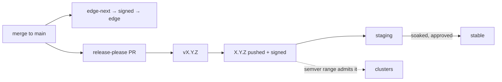

# Releases & channels

Clusters follow **version tags** through the seed's semver range (`PATCHY_MANIFESTS_SEMVER`). The channel tags exist for
humans, for `flux pull artifact`, and for the platform's own smoke tests.

| Workflow            | Trigger                          | Pushes                                     | Then                                  |
| ------------------- | -------------------------------- | ------------------------------------------ | ------------------------------------- |
| `release.yaml`      | push to `main`                   | release-please keeps a release PR current  | cuts `vX.Y.Z` when that PR merges     |
| `publish.yaml`      | the release                      | `manifests/patchy:X.Y.Z` to every registry | signs each digest, moves `staging`    |
| `publish-edge.yaml` | every merge to `main`            | `manifests/patchy:edge-next`               | signs, then moves `edge`              |
| `promote.yaml`      | manual, `production` environment | nothing new                                | moves `stable` to a published version |

The `edge` image is pushed as `edge-next`, signed, and only then retagged `edge`, so the channel never points at an
unsigned digest. Promotion moves the channel only: the image and its signature are untouched, because verification
follows the digest.

## Signing

Signing is keyless. The Fulcio certificate subject is the calling workflow at its ref, which is what the seed's
`OCIRepository` verify block (`SIGNED_IDENTITY_PATCHY_MANIFESTS`) matches on every cluster:

- releases are signed as `…/patchy-app-manifests/.github/workflows/publish.yaml@refs/tags/v*`;
- edge images are signed as `…/patchy-app-manifests/.github/workflows/publish-edge.yaml@refs/heads/main`, a distinct
  identity.

cosign v3 stores the signature as a sigstore bundle through the OCI referrers API.

## Registries

One job publishes to both registries; `scripts/publish.sh` does the pushing, signing and retagging.

- **GAR**: org variables `PLATFORM_REGISTRY`, `GCP_WIF_PROVIDER` and `GCP_MANIFEST_PUBLISHER_SA`. The service account is
  this repository's own publisher, set as a repository variable that shadows the org one. Authentication is Workload
  Identity Federation.
- **ECR**: org variables `AWS_MANIFEST_PUBLISHER_ROLE`, `AWS_PLATFORM_REGISTRY` and `AWS_REGION`. The role is the
  artifact-store module's `manifest_publishers["patchy-app-manifests"]`, path-scoped to `manifests/patchy` so this
  repository can never overwrite the platform. The ECR half is skipped when `AWS_MANIFEST_PUBLISHER_ROLE` is unset.

## This site

The release workflow also publishes this documentation site to GitHub Pages, built at the release tag. CI builds it on
every pull request. See [Working on the docs](../reference/docs.md).
