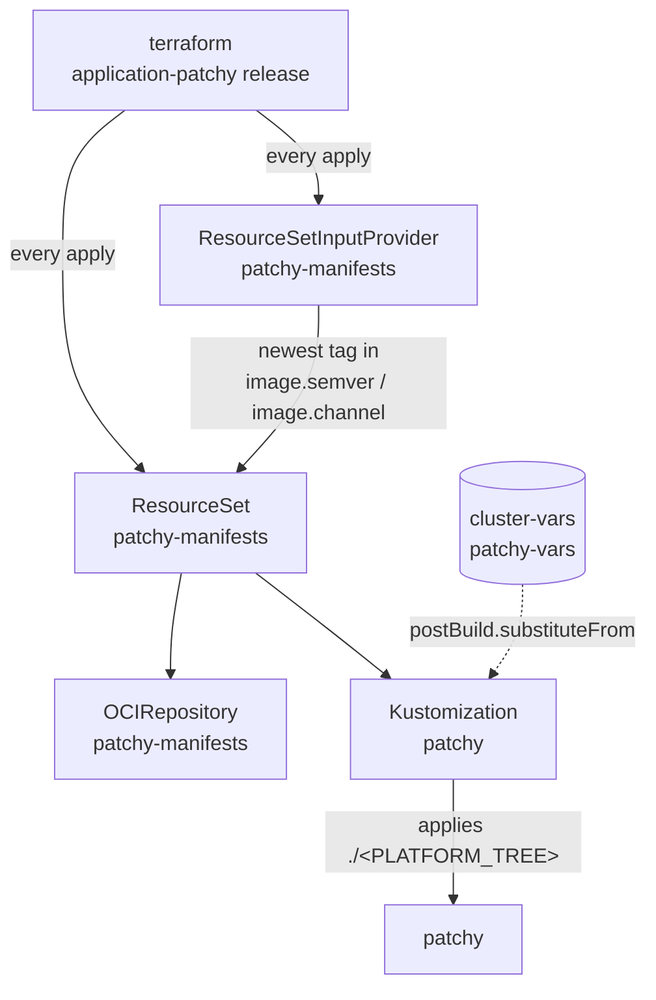

# The seed contract

The cluster modules' `modules/application` creates two objects in `flux-system` through the `application-patchy` helm
release, and keeps them under terraform on every apply. This image ships no copy of them: the seed decides **which**
build a cluster runs, and the image decides **what** that build deploys. Their names are a fixed contract between the
three repositories:

| Object                     | Name               | Namespace     | Owner                              |
| -------------------------- | ------------------ | ------------- | ---------------------------------- |
| `ResourceSetInputProvider` | `patchy-manifests` | `flux-system` | terraform (`modules/{aws,google}`) |
| `ResourceSet`              | `patchy-manifests` | `flux-system` | terraform (`modules/{aws,google}`) |
| `OCIRepository`            | `patchy-manifests` | `flux-system` | `ResourceSet/patchy-manifests`     |
| `Kustomization`            | `patchy`           | `flux-system` | `ResourceSet/patchy-manifests`     |
| `ConfigMap` (substitution) | `cluster-vars`     | `flux-system` | terraform (the cluster root)       |
| `ConfigMap` (substitution) | `patchy-vars`      | `flux-system` | terraform (`modules/{aws,google}`) |

## How it works

- **Terraform picks the build.** The modules' `image` (`semver`, `channel`) passes straight through to the seed: by
  default the newest release in `<1.0.0 >=0.1.0`, or a channel's newest immutable build. The ResourceSet turns the
  newest match into a digest-pinned, signature-verified `OCIRepository`, and the `Kustomization` that applies
  `./<PLATFORM_TREE>` (`./aws` or `./google`) from it, substituting from `cluster-vars` and `patchy-vars`.
- **The range moves with the infrastructure.** A release that needs new infrastructure (roles, grants, secret
  containers) is a breaking release. The module version that adds that infrastructure also moves the range, so both land
  in the same apply. Within a range, a release must never need new infrastructure.
- **The image ships no seed objects.** An image that carried its own copy would have its Kustomization re-apply it on
  every reconcile and fight terraform.
- **Destroying the module uninstalls patchy.** The ResourceSet finalizer garbage-collects the Kustomization, whose
  finalizer prunes patchy.

!!! danger "Keep the range honest"

    A range matching **no** tag empties the ResourceSet, which prunes the application. The `edge` channel follows
    every edge build unless `semver` bounds it (`^0.2.0-0`), so an edge cluster can run a breaking build before its
    infrastructure is applied.
