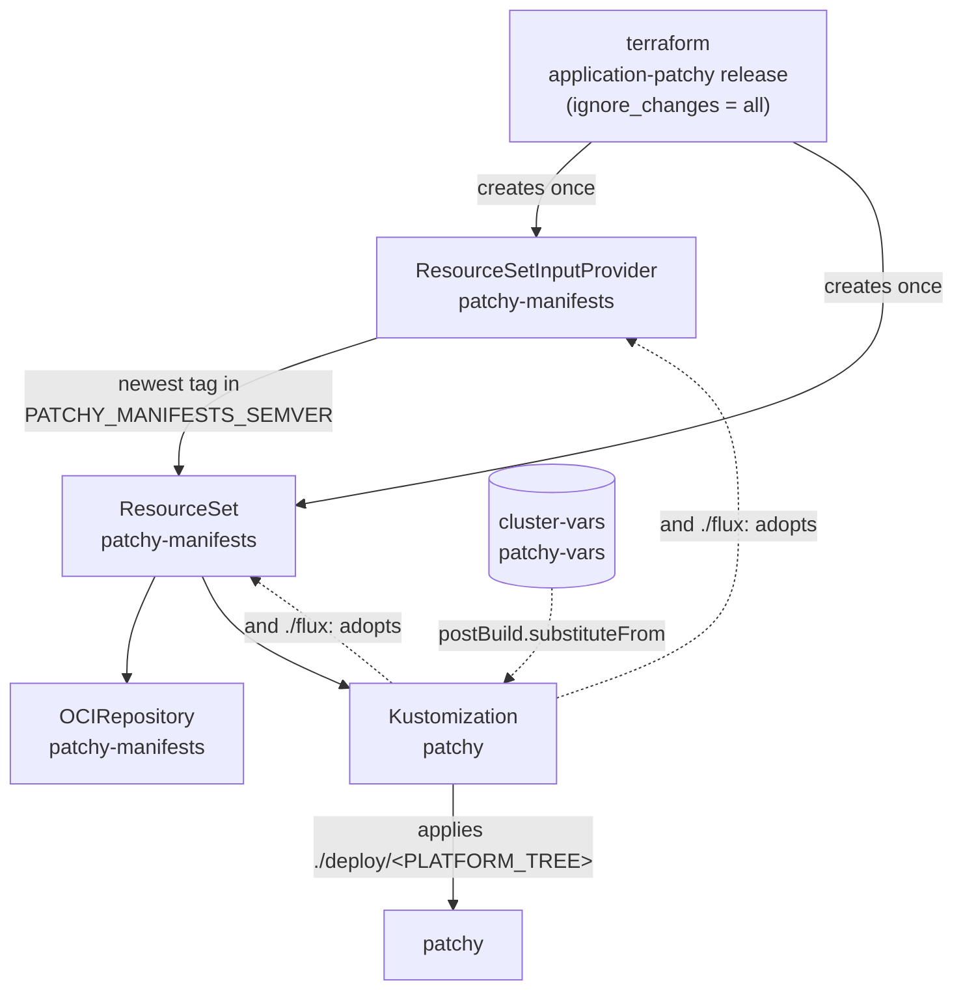

# The seed contract

The cluster modules' `modules/application` creates two objects in `flux-system`, bootstrap-only: the
`application-patchy` helm release, under `ignore_changes = all`. This image ships the same two objects under
`manifests/flux/`, so the first reconcile adopts them. Their names are a fixed contract between the three repositories:

| Object                     | Name               | Namespace     | Owner after hand-over              |
| -------------------------- | ------------------ | ------------- | ---------------------------------- |
| `ResourceSetInputProvider` | `patchy-manifests` | `flux-system` | `Kustomization/patchy`             |
| `ResourceSet`              | `patchy-manifests` | `flux-system` | `Kustomization/patchy`             |
| `OCIRepository`            | `patchy-manifests` | `flux-system` | `ResourceSet/patchy-manifests`     |
| `Kustomization`            | `patchy`           | `flux-system` | `ResourceSet/patchy-manifests`     |
| `ConfigMap` (substitution) | `cluster-vars`     | `flux-system` | terraform (the cluster root)       |
| `ConfigMap` (substitution) | `patchy-vars`      | `flux-system` | terraform (`modules/{aws,google}`) |

## How the hand-over works

- **The provider follows version tags.** `PATCHY_MANIFESTS_SEMVER` (default `<1.0.0 >=0.1.0`) selects the image tags.
  The ResourceSet turns the newest match into a digest-pinned, signature-verified `OCIRepository`, and the
  `Kustomization` that applies `./deploy/<PLATFORM_TREE>` from it, substituting from `cluster-vars` and `patchy-vars`.
- **The seed objects can't be pruned.** Both carry `kustomize.toolkit.fluxcd.io/prune: disabled`, in the seed and in the
  image. The Kustomization applies its own parents, and must never be able to prune them: an image that dropped `flux/`
  by mistake would otherwise garbage-collect itself and every patchy object with it.
- **After hand-over the image owns its own definition.** The semver floor, the `dependsOn` gates, the verify identity
  and the interval all live in the image, so a manifests release changes them with no terraform apply.
- **Destroying the module uninstalls patchy.** The ResourceSet finalizer garbage-collects the Kustomization, whose
  finalizer prunes patchy.

!!! danger "Keep the floor honest"

    A range matching **no** tag empties the ResourceSet, which prunes the application.

## Where it's enforced

`make test` asserts the contract on every tree: `flux-system` must carry exactly the RSIP and ResourceSet
`patchy-manifests`, both prune-disabled, and `ResourceSet/patchy-manifests` must emit `Kustomization/patchy`. See
[Tasks & validation](../reference/tasks.md).
