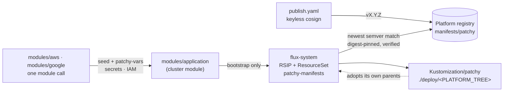

# Overview

patchy-app-manifests publishes [patchy](https://github.com/bitwise-media-group/patchy) as a self-owned **application
image** for the platform clusters. The image, `oci://<registry>/manifests/patchy`, is a cosign-signed OCI artifact
holding everything patchy deploys on a cluster: the chart releases, the secret syncs, the RBAC bindings and the
image-verification policy, plus its own flux self-definition.

The terraform modules under `modules/` install it onto a cluster as a self-contained application. They seed the image
once, and flux owns it from then on. They also create everything it needs outside the cluster (secret containers, IAM
grants and the `patchy-vars` ConfigMap) through the cluster modules' generic `modules/application`. The cluster module
itself has no knowledge of patchy.

## Why a separate image

Until 4.0 of [flux-manifests](https://github.com/bitwise-media-group/flux-manifests), this content lived inside the
platform artifact as its `patchy` and `patchy-cloud` components, elected through `STACK_COMPONENTS`. Splitting it out
means:

- an application release and a platform release are no longer the same release;
- the platform carries nothing patchy-specific;
- a cluster that doesn't run patchy never sees its IAM, secrets or SSO wiring.

## Where it sits



| Repository                                                                                    | Role                                                                                      |
| --------------------------------------------------------------------------------------------- | ----------------------------------------------------------------------------------------- |
| **patchy-app-manifests** (this)                                                               | the application image, and the per-cloud terraform modules that install it onto a cluster |
| [flux-manifests](https://github.com/bitwise-media-group/flux-manifests)                       | the platform: the entrypoint the FluxInstance syncs and the per-component images          |
| [terraform-aws-eks-flux](https://github.com/bitwise-media-group/terraform-aws-eks-flux)       | the EKS cluster module; `modules/aws` installs through its `modules/application`          |
| [terraform-google-gke-flux](https://github.com/bitwise-media-group/terraform-google-gke-flux) | the GKE sibling; `modules/google` installs through its `modules/application`              |

## Repository layout

```text
manifests/                            <- the image root (flux push artifact --path manifests)
  flux/                               the self-definition (RSIP + ResourceSet)
  deploy/common/                      cloud-neutral: namespaces, chart releases, rbac, policy
  deploy/aws/                         + ../../flux, the aws secret-sync dialect (Secrets Store CSI + SecretSync)
  deploy/google/                      + ../../flux, GKE Integrated Secret Synchronization, HealthCheckPolicies
modules/aws, modules/google           the installers: one module call against a cluster's application_target
modules/scc-notifications             standalone, google-only: Security Command Center findings to patchy
scripts/validate.sh, tests/           the render + schema harness (make test)
scripts/publish.sh, .github/workflows the release pipeline (push, sign, tag; GAR and ECR)
docs/ · zensical.toml · overrides/    this site
```

`deploy/common` may not branch on cloud. The one cloud-shaped value it needs, the KMS URI scheme of the keyed attestor,
keys off `OCI_PROVIDER`, which the aws platform publishes and google leaves to the `gcp` default.

## Prerequisites

- **A platform cluster** built with terraform-aws-eks-flux or terraform-google-gke-flux, whose root exposes the
  `application_target` output.
- **A flux-manifests release** the image is compatible with. Dex clients need one that runs the dex-client-controller;
  see [Caveats](../concepts/caveats.md).
- **mise** (`brew install mise`) to work on this repository. Every other tool is pinned: kustomize, kubeconform, yq and
  the flux-operator CLI in the root `mise.toml`, and terraform, uv and the linters via the shared
  [toolchain](https://oss.bitwisemedia.uk/toolchain/) mounted at `.mise/`.

## Next steps

- [Install patchy](installing.md) onto a cluster.
- Read [The seed contract](../concepts/seed-contract.md) for how terraform hands the application over to flux.
- Check [What the image deploys](../concepts/deploys.md) for the objects that land on the cluster.
